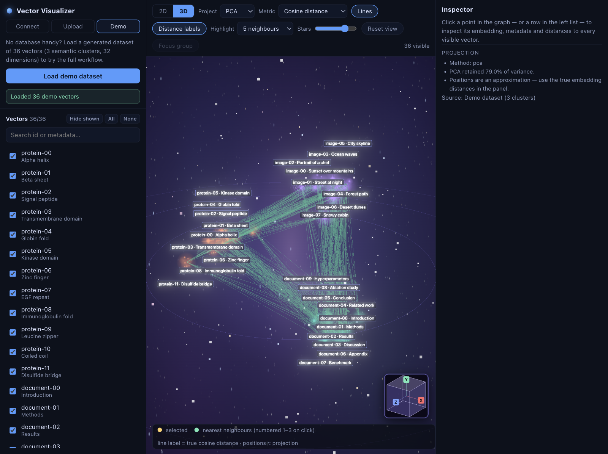
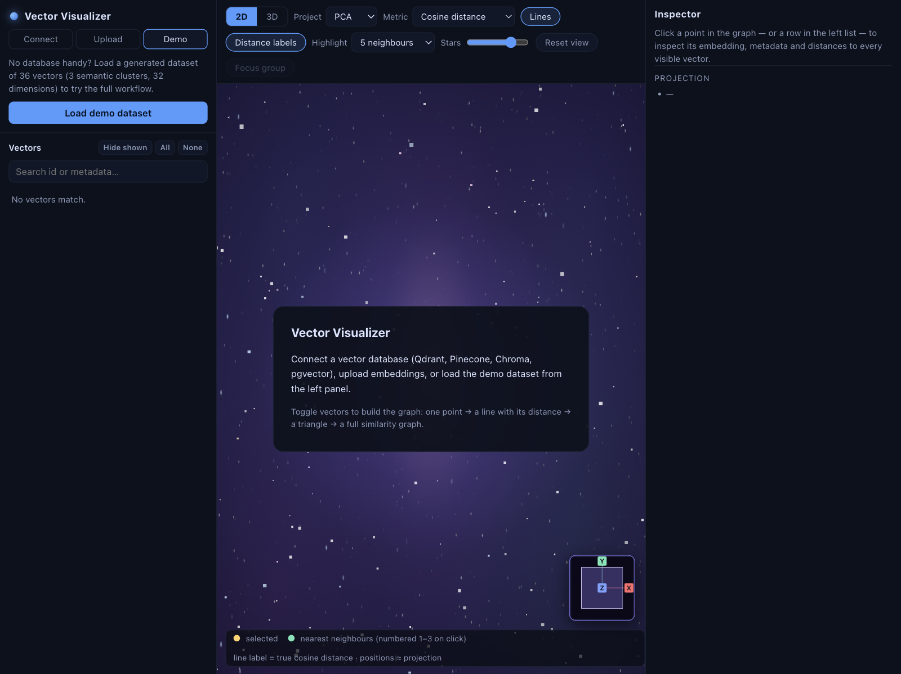
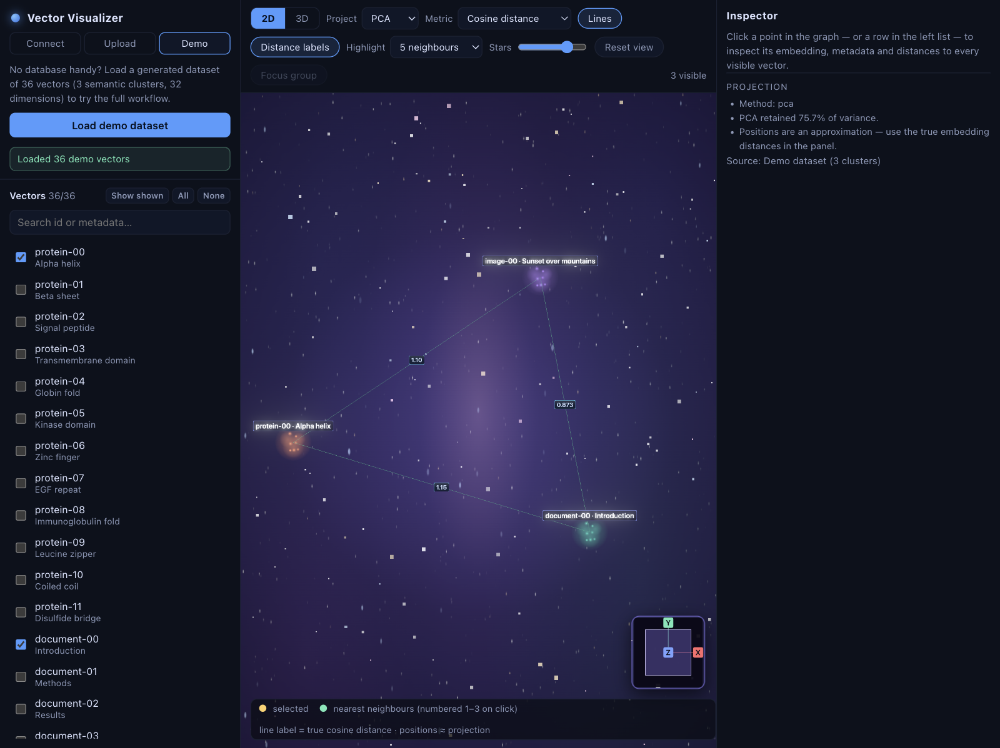
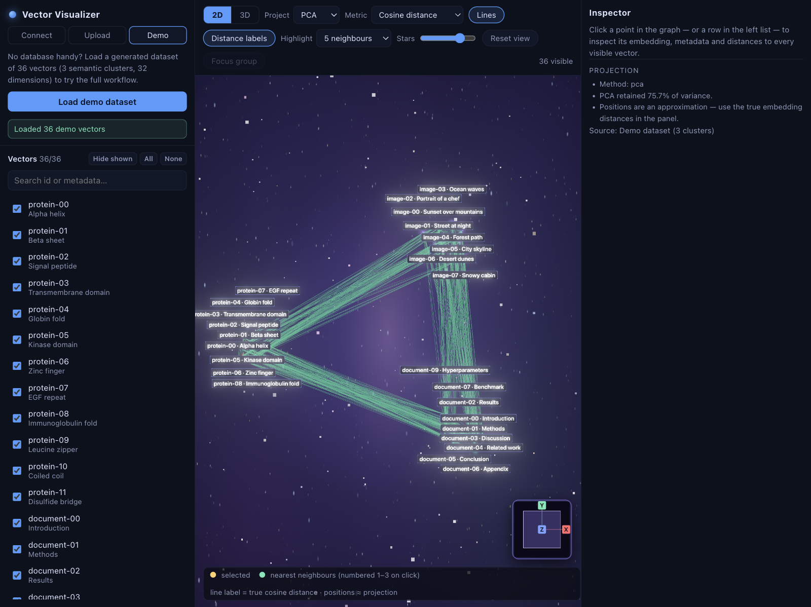
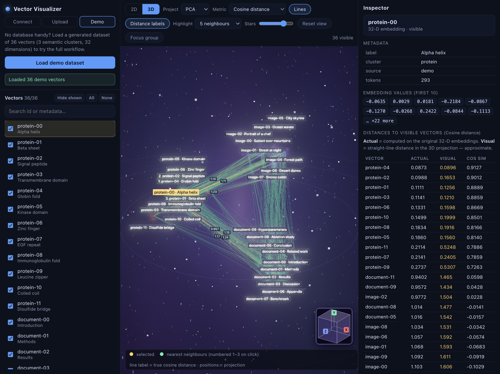

# Vector Visualizer

**See what your embeddings actually mean.** Vector Visualizer is an interactive 3D graph explorer
for vector databases and embedding files: load vectors, project them into 2D/3D, and fly through
the result as a small galaxy — where every star is a vector, every filament a true similarity, and
every cluster a topic your model discovered.



---

## What it does

### 1. Bring your own vectors

Start from a vector database (**Qdrant, Pinecone, Chroma, pgvector**), drag in a
**JSON / JSONL / CSV** file of embeddings, or hit one button for a generated **demo dataset**
(36 vectors in 3 semantic clusters, 32 dimensions) — no database required.

The left sidebar lists everything with a search box and per-vector visibility toggles, so you can
narrow a 10,000-row collection down to the vectors you actually care about.



### 2. Build the graph yourself, one vector at a time

Datasets load with *nothing* enabled — you decide what appears:

| Enabled | What you see |
|--------:|--------------|
| 1 | a labeled point |
| 2 | a line, labelled with the **true distance** between them |
| 3 | a triangle with all three distances labelled |
| 4+ | the full similarity graph |

Toggling never resets the view — the graph grows and shrinks in place. Here are three vectors
(one from each cluster) with their pairwise cosine distances on the edges:



### 3. Project, compare, and keep the truth straight

The layout is **PCA, MDS, or UMAP** reduced to 2D or 3D — but distances on the screen are an
*approximation*, and the app never pretends otherwise:

- **Line labels and the `Actual` column** = true cosine / Euclidean distance computed on the
  original 32-D (or 1024-D…) embeddings.
- **The `Visual` column** = straight-line distance in the projection — approximate.

Comparing those two columns side by side is often the fastest way to spot what a projection is
distorting. Switch 2D ⇄ 3D, swap projections, and swap metrics (cosine similarity / cosine
distance / Euclidean) from the toolbar without losing your selection.



### 4. Click anything to interrogate it

Click a point (or a row in the list) to open the **Inspector** on the right:

- metadata (label, cluster, source, …) and raw embedding values,
- distances from that vector to **every visible vector** — actual vs. visual, plus cosine
  similarity, sorted nearest-first,
- its **nearest neighbours**, numbered `1. 2. 3.` **in the graph itself** so the ranked list and
  the picture line up,
- non-neighbours dim so the local neighbourhood pops.



### 5. It's also just nice to look at

The scene is rendered as a little cosmos: every vector is a procedural **cosmic body** — spiral
galaxy, radiant star, nebula star-cluster, or binary star — tinted per cluster (amber when
selected, mint for nearest neighbours), floating over a baked **nebula backdrop** with a drifting,
twinkling **starfield**, a soft **galactic-core glow**, and faint **orbital rings** marking the
galactic plane in 3D. Everything runs through **bloom post-processing**, so the hot cores really
glow. Lines read as soft green filaments; connections to your selection glow golden.

A **navigation cube** in the corner mirrors the camera: **grab it and drag** to orbit, or click
an axis badge (X/Y/Z) to snap the view to that direction (3D only).

### Controls at a glance

- **Pan / zoom / rotate** — drag to orbit (3D), scroll to zoom to the cursor.
- **2D ⇄ 3D**, projection (PCA/MDS/UMAP), metric — top toolbar.
- **Lines / Distance labels** — toggle the edges and their true-distance chips.
- **Highlight** — how many nearest neighbours to rank (3/5/10/15).
- **Stars** — slider capping how large the cosmic markers may grow on screen.
- **Search & filter** — left sidebar; **Inspector & distances** — right sidebar.
- Labels never overlap: a per-frame declutter pass nudges them apart (selected → numbered
  neighbours → the rest) and hides anything that can't fit until you zoom in.
- In 2D no two markers can ever overlap: each is capped to just under half its nearest
  neighbour's screen distance, so flat layouts stay readable at any zoom.

---

## Tech stack

| Layer    | Tech |
|----------|------|
| Frontend | React, TypeScript, Vite, Three.js (bloom post-processing) |
| Backend  | Python, FastAPI, NumPy, scikit-learn, umap-learn |
| DB access| httpx (Qdrant / Pinecone / Chroma REST), psycopg (pgvector) |

## Getting started

Prerequisites: **Node 20+** and **[uv](https://docs.astral.sh/uv/)** (or Python 3.12+ / pip).

```bash
# one command starts both servers
./scripts/dev.sh
```

or manually:

```bash
# backend  (http://127.0.0.1:8000, interactive docs at /docs)
cd backend
uv sync
uv run uvicorn app.main:app --port 8000 --reload

# frontend (http://localhost:5173, proxies /api to the backend)
cd frontend
npm install
npm run dev
```

Open **http://localhost:5173** and click **Load demo dataset**, then **All**.

## File formats

```json
// .json — list of records (also accepts {"vectors": {...}} and {"ids": [...], "embeddings": [[...]]})
[{ "id": "doc-1", "embedding": [0.12, 0.98], "metadata": {"title": "…"}}]
```

```jsonl
// .jsonl — one record per line, same shape as above
```

```csv
// .csv — id column + either numeric dimension columns, or an embedding column holding a JSON list
id,embedding,label
v1,"[0.11,0.92,0.44]",Alpha helix
```

Samples live in `samples/`.

## Connection settings

| Database   | Config fields |
|------------|---------------|
| Qdrant     | `url`, `api_key` (optional), collection |
| Pinecone   | index **host** (e.g. `idx-xxx.svc.aped-4627-b74a.pinecone.io`), `api_key`, optional `namespace`, index name |
| Chroma     | `url`, optional `tenant` / `database`, collection |
| pgvector   | postgres DSN, table (e.g. `public.docs`), optional `id_column` / `embedding_column` |

The **List collections** button discovers what's available for each backend.

## API

| Method | Path | Purpose |
|--------|------|---------|
| GET  | `/api/health` | liveness |
| GET  | `/api/demo`   | generated demo dataset |
| POST | `/api/upload`   | multipart file → vectors |
| POST | `/api/connect`  | database config → vectors |
| POST | `/api/collections` | list collections/tables/indexes |
| POST | `/api/project`  | PCA/MDS/UMAP → 2D/3D coordinates |
| POST | `/api/distances`| true metric matrix for a subset of ids |
| POST | `/api/neighbors`| top-k nearest neighbours |

## Notes & MVP limits

- Large datasets: projection and distances are recomputed for the enabled subset, so enabling
  hundreds of vectors stays fast. MDS is capped at 400 points (classical MDS beyond that),
  PCA scales to any size, UMAP needs ≥ 8 vectors (falls back to classical MDS below that).
- Distance labels auto-cap at 90 pairs — beyond that only the selected vector's connections are
  labelled (a hint explains this).
- Label decluttering prefers information: selected → numbered neighbours (1–3) → other
  neighbours → point labels → distance labels. High-priority labels nudge out of the way before
  being hidden.
- The backend allows CORS from any origin, and the Vite dev server proxies `/api`.
